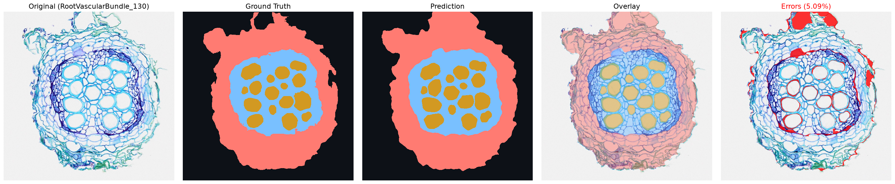
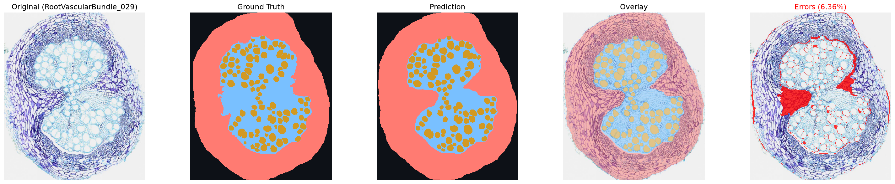
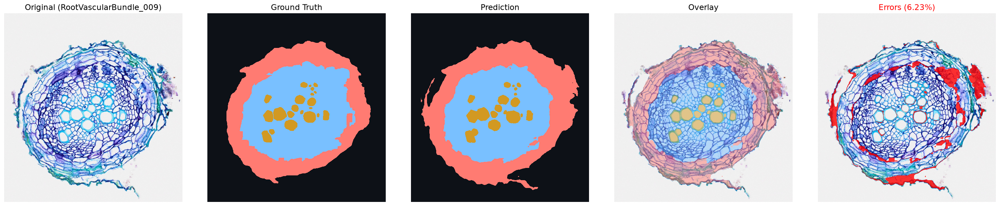
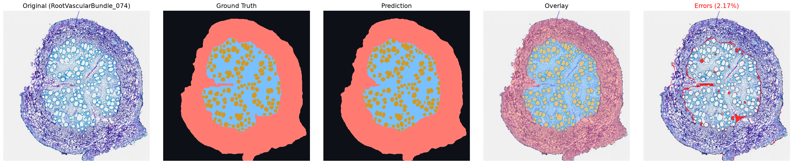

# Root Cross-Section Segmentation

Semantic segmentation of plant root cross-sections (`root`, `stele`, `xylem`) using **nnU-Net v2**, orchestrated through MONAI's `nnUNetV2Runner` and configured with **Hydra** (`cfg/`).

## Dataset

Images and annotations come from the **xylem2** dataset by Hasib, published on [Roboflow Universe](https://universe.roboflow.com/hasib/xylem2). `make download` fetches it as a COCO segmentation export. If you use it, please cite:

```bibtex
@misc{ xylem2_dataset,
  title = { xylem2 Dataset },
  type = { Open Source Dataset },
  author = { Hasib },
  howpublished = { \url{ https://universe.roboflow.com/hasib/xylem2 } },
  url = { https://universe.roboflow.com/hasib/xylem2 },
  journal = { Roboflow Universe },
  publisher = { Roboflow },
  year = { 2025 },
  month = { feb },
  note = { visited on 2026-10-14 },
}
```

## Setup

Create a `.env` file in the project root with your Roboflow API key (and optionally your Weights & Biases API key for experiment tracking):

```env
ROBOFLOW_API_KEY=your_roboflow_api_key_here
WANDB_API_KEY=your_wandb_api_key_here
```

> **Important:** Write the key values **without quotes** (`"` or `'`). `docker run --env-file` does not strip quotes and will pass them literally as part of the API keys.

## Local Workflow (`uv`)

Requires [uv](https://docs.astral.sh/uv/) (and optionally `direnv` for automatic environment variable loading from `.envrc`).

Install dependencies:

```bash
uv sync
```

Run the full data preparation and verification pipeline (`download` → `convert` → `test` → `integrity`):

```bash
make all
```

Or run each step individually:

| Command | Description |
| :--- | :--- |
| `make download` | Download the COCO segmentation dataset from Roboflow into `coco_semantic_segmentation_dataset/` (skipped if a split with `_annotations.coco.json` already exists; delete `coco_semantic_segmentation_dataset/` to force a re-download). |
| `make convert` | Rasterize COCO polygons in class order (`root` → `stele` → `xylem`) and export the dataset to `data/nnUNet_raw/` with specimen-grouped folds (`splits_final.json`). |
| `make test` | Run `pytest` unit and dataset checks (class nesting, exclusive masks, zero specimen group leakage, and no near-duplicate images across the test set and CV folds). |
| `make integrity` | Extract dataset fingerprint, generate 2D plans, and preprocess into `data/nnUNet_preprocessed/` (`monai.train.enabled=false`). |
| `make visualize` | Generate `1x5` validation comparison figures into `results/fold_<n>/` for all trained folds discovered on disk. |

To train locally (e.g., on Apple Silicon with `mps`):

```bash
uv run python -m src.main monai.preprocess.enabled=false
```

## Cloud / VM Workflow (Docker + GPU)

Designed for GPU instances (e.g., a GCP VM with an NVIDIA L4).

**VM Prerequisites:**
- Clone the repository and create `.env` in the project root (`ROBOFLOW_API_KEY=...` and optionally `WANDB_API_KEY=...`, without quotes).
- `make`, **Docker**, and **NVIDIA Container Toolkit** installed on the host.

All `*-vm` targets automatically mount four host directories into the container so data and outputs persist with your host user permissions:
- `coco_semantic_segmentation_dataset/` → `/app/coco_semantic_segmentation_dataset` (Roboflow COCO export)
- `data/` → `/app/data` (nnU-Net raw data, preprocessed data, and trained models)
- `results/` → `/app/results` (`1x5` validation comparison figures per fold)
- `logs/` → `/app/logs` (Hydra execution logs)

### Step-by-Step Execution

1. **Build the Docker image:**
   ```bash
   make docker-build
   ```

2. **Download and convert the dataset:**
   ```bash
   make download-vm
   make convert-vm
   ```
   *(If `coco_semantic_segmentation_dataset/` already contains a split with annotations, `make download-vm` skips the download. Delete the folder first if you need to download a fresh copy).*

3. **Run fingerprint extraction, planning, and preprocessing:**
   ```bash
   make preprocess-vm
   ```

4. **Start GPU training:**
   ```bash
   make train-vm
   ```

5. **Generate validation visualizations (`1x5`):**
   ```bash
   make visualize-vm
   ```

### Passing Hydra Overrides (`ARGS`)

All `Makefile` pipeline targets accept Hydra configuration overrides via `ARGS`:

```bash
# Re-convert overwriting an existing export (always re-run preprocess-vm afterwards
# so the dataset fingerprint, plans, and preprocessed data are updated)
make convert-vm ARGS="export.overwrite=true"
make preprocess-vm

# Train fold 1 for 250 epochs with Weights & Biases logging enabled
make train-vm ARGS="logger.enabled=true monai.train.fold=1 monai.runner.trainer_class_name=nnUNetTrainerMetrics_250epochs"

# Resume training from the latest checkpoint
make train-vm ARGS="monai.train.continue_training=true"

# Train without torch.compile (no compilation time on the first epoch, but slower epochs)
make train-vm ARGS="monai.train.compile=false"

# Visualize all trained folds of the 250-epoch trainer, or a single specific fold
make visualize-vm ARGS="monai.runner.trainer_class_name=nnUNetTrainerMetrics_250epochs"
make visualize-vm ARGS="monai.visualize.folds=[fold_1]"
```

## Experiment Tracking (Weights & Biases)

`src/main.py` configures nnU-Net v2's built-in `WandbLogger` using `cfg/logger/wandb.yaml` (`enabled`, `project`, `mode`). By default, `logger.enabled` is `false` so local checks and preprocessing runs do not require a W&B account.

To log training runs to W&B:
1. Add `WANDB_API_KEY=your_wandb_api_key_here` (without quotes) to `.env`.
2. Pass `logger.enabled=true` via `ARGS` (or set `enabled: true` in `cfg/logger/wandb.yaml`):
   ```bash
   make train-vm ARGS="logger.enabled=true"
   ```

**Run organization:** each experiment (trainer + configuration, e.g. `nnUNetTrainerMetrics_250epochs__2d`) is a W&B *group* with one run per fold (`fold_00` … `fold_04`), plus tags for the configuration, fold and trainer (`group`, `name` and `tags` in `cfg/logger/wandb.yaml`). Group the runs table by *Group* to compare and average the folds of an experiment. Train all five folds with:

```bash
for f in 0 1 2 3 4; do
  make train-vm ARGS="logger.enabled=true monai.train.fold=$f" || break
done
```

**Metrics:** the default trainer, `nnUNetTrainerMetrics_<N>epochs` (`src/trainers/`), extends nnU-Net's `nnUNetTrainer`, which only logs losses, learning rate and the pseudo Dice per class. It adds, per class (`root`, `stele`, `xylem`) and as the foreground mean:

| W&B key | When | Computed on |
| :--- | :--- | :--- |
| `val_dice/*`, `val_iou/*`, `val_precision/*`, `val_recall/*` | Every epoch (charts) | Validation patches sampled during training (pseudo metrics) |
| `final_val/<metric>/*` (run summary) and `final_val/per_case` (table) | Once, after training | Full validation images (`validation/summary.json`), averaged over cases |

nnU-Net finds these trainers through `nnUNet_extTrainer` (set by `src/main.py`, the Dockerfile and `.envrc`); set it too when running `nnUNetv2_predict` by hand on these models. nnU-Net's own `nnUNetTrainer_<N>epochs` classes still work, without the extra metrics.

## Results

Five-fold cross-validation of the 2D configuration (`nnUNetTrainerMetrics_100epochs`, 127 training images grouped by specimen), evaluated by nnU-Net on the full validation images of each fold. Values are **mean / median over the validation cases** of each fold; the last row is the mean ± SD of the five fold means.

**Dice**

| Fold | n | Root | Stele | Xylem | Foreground |
| :--- | ---: | :---: | :---: | :---: | :---: |
| 0 | 28 | 0.909 / 0.947 | 0.846 / 0.893 | 0.918 / 0.921 | 0.891 / 0.923 |
| 1 | 24 | 0.931 / 0.959 | 0.851 / 0.895 | 0.897 / 0.915 | 0.893 / 0.915 |
| 2 | 24 | 0.940 / 0.968 | 0.881 / 0.902 | 0.901 / 0.908 | 0.907 / 0.917 |
| 3 | 24 | 0.929 / 0.962 | 0.850 / 0.884 | 0.906 / 0.904 | 0.895 / 0.910 |
| 4 | 27 | 0.909 / 0.965 | 0.839 / 0.892 | 0.924 / 0.927 | 0.891 / 0.924 |
| **Mean ± SD** | | **0.923 ± 0.014** | **0.853 ± 0.016** | **0.909 ± 0.012** | **0.895 ± 0.007** |

**IoU**

| Fold | n | Root | Stele | Xylem | Foreground |
| :--- | ---: | :---: | :---: | :---: | :---: |
| 0 | 28 | 0.844 / 0.899 | 0.745 / 0.807 | 0.850 / 0.853 | 0.813 / 0.860 |
| 1 | 24 | 0.885 / 0.921 | 0.758 / 0.811 | 0.815 / 0.843 | 0.820 / 0.844 |
| 2 | 24 | 0.894 / 0.937 | 0.798 / 0.822 | 0.822 / 0.832 | 0.838 / 0.850 |
| 3 | 24 | 0.874 / 0.927 | 0.750 / 0.792 | 0.829 / 0.825 | 0.817 / 0.837 |
| 4 | 27 | 0.847 / 0.933 | 0.742 / 0.806 | 0.860 / 0.863 | 0.816 / 0.861 |
| **Mean ± SD** | | **0.869 ± 0.022** | **0.758 ± 0.023** | **0.835 ± 0.019** | **0.821 ± 0.010** |

Xylem is segmented consistently across folds (mean ≈ median). For root and stele the median is clearly above the mean: a few cases with coarse or inconsistent annotations of the stele boundary (part of the cortex labeled as stele) pull the mean down, while the predictions follow the anatomical boundary.

**Validation examples**, one per fold: original image, ground truth, prediction, overlay and pixel errors. Most of the remaining error lies on class boundaries, where the polygon annotations are coarse.

Fold 0: `root_cross_section_130`



Fold 1: `root_cross_section_094`



Fold 2: `root_cross_section_009`



Fold 3: `root_cross_section_074`



Fold 4: `root_cross_section_029`


To summarize all trained folds of a model (mean/median Dice and IoU per class, mean ± SD across folds, and lowest-Dice cases) and save the report to `results/cv_summary.md`:

```bash
make summarize
# Or inside Docker on the VM:
make summarize-vm ARGS="monai.runner.trainer_class_name=nnUNetTrainerMetrics_100epochs"
```

## Outputs & Logs

- **nnU-Net checkpoints and validation results:** `data/nnUNet_results/Dataset001_RootCrossSection/`
- **Validation `1x5` comparison figures and CV summary:** `results/fold_<n>/` and `results/cv_summary.md`
- **Preprocessed dataset, fingerprint, and plans:** `data/nnUNet_preprocessed/Dataset001_RootCrossSection/`
- **Hydra run logs and resolved configs:** `logs/runs/<YYYY-MM-DD>/<HH-MM-SS>/`

## Project Structure

```text
├── cfg/                  # Hydra configuration (paths, export, monai, roboflow, logger, hydra)
├── src/
│   ├── main.py           # Planning, preprocessing, and training entry point
│   ├── trainers/         # Custom nnU-Net trainers (extra W&B metrics), found via nnUNet_extTrainer
│   └── utils/
│       ├── download.py   # Roboflow dataset downloader
│       ├── convert.py    # COCO-to-nnU-Net converter and grouped fold splitter
│       ├── coco.py       # COCO reader, class mapping, polygon rasterization, and group extraction
│       ├── visualize.py  # 1x5 validation prediction visualizer
│       ├── summarize.py  # Cross-validation summary (mean/median Dice and IoU per fold, worst cases)
│       └── resolvers.py  # Custom OmegaConf resolvers (splits, trained folds, and device)
├── tests/                # Synthetic and real-dataset validation tests
├── notebooks/            # Exploratory data analysis
├── Dockerfile            # Container image for cloud/VM execution
└── Makefile              # Local and Docker pipeline targets
```
